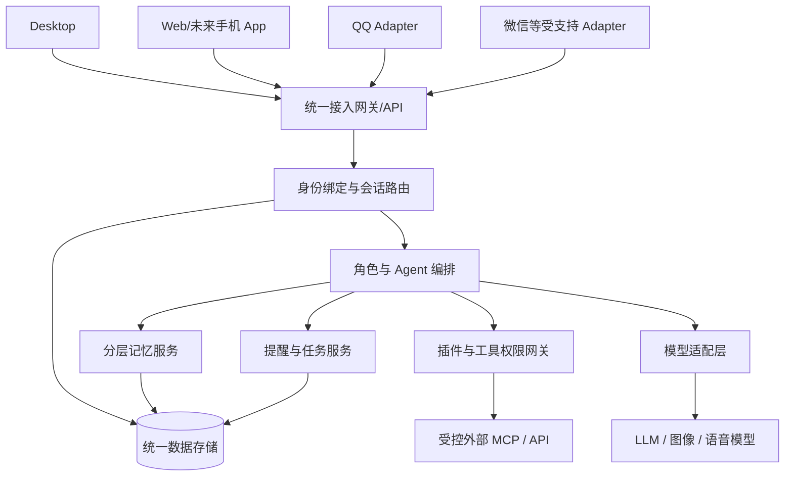

# 目标架构草案（未冻结）

- 状态：PROPOSED / 未评审
- 日期：2026-11-04

## 1. 架构目标

统一角色与数据中心，接入层可替换；Desktop、Web、移动端、多种消息渠道可以同时访问同一个 AI 角色，权限与插件单独治理。

## 2. 职责边界

| 组件 | 核心职责 | 不应承担 |
|---|---|---|
| 渠道适配器 | 消息收发、归一化、能力声明、幂等 | 唯一长期记忆主档 |
| 身份服务 | 平台 user_id、绑定与撤销、授权 | 仅凭昵称合并身份 |
| 会话服务 | 角色路由、群聊/私聊范围、上下文 | 把所有群消息合成全局历史 |
| 角色核心 | 人格、模型与工具编排 | 绕过权限执行写操作 |
| 记忆服务 | 候选抽取、核验、检索、改删、隔离 | 把未经核验传言固化 |
| 任务服务 | 调度、待办、提醒、投递与重试 | 以 AI 文本代替投递成功 |
| 插件管理 | 安装、版本、权限和故障治理 | 默认信任外部代码 |
| Desktop | 图形管理、配置、诊断和备份 | 成为不可关闭的唯一在线核心 |

## 3. 最小数据模型

| 实体 | 字段示例 |
|---|---|
| User | `user_id`, `status` |
| ChannelIdentity | `channel`, `external_user_id`, `user_id`, `verified_at` |
| Character | `character_id`, `owner_id`, `persona_version`, `visibility` |
| Conversation | `conversation_id`, `channel`, `external_chat_id`, `scope`, `character_id` |
| Message | `message_id`, `external_message_id`, `conversation_id`, `sender_id`, `content`, `delivery_status` |
| Memory | `memory_id`, `owner_id`, `character_id`, `scope`, `source_ref`, `expires_at` |
| Task | `task_id`, `owner_id`, `conversation_id`, `schedule`, `due_at`, `status` |
| Plugin | `plugin_id`, `version`, `publisher`, `permissions`, `compatibility` |
| ToolGrant | `tool_id`, `subject_id`, `scope`, `policy`, `approved_at` |

字段只是设计草案，不是最终数据库迁移。多租户时应额外设计 Workspace/Tenant 及成员访问。

## 4. 跨平台持续性

1. Desktop、Web、App 通过同一账号访问角色和个人私聊历史。
2. QQ/微信账号通过双向验证绑定到内部用户 ID；未经验证不能合并。
3. 同一角色可以有多个会话和不同的群记忆，私聊不能随意读取群历史。
4. 渠道发送失败、限流与功能缺失需有明确状态和降级路径。
5. 工作权限不因用户跨平台或加入指定工作群而自动升级。

## 5. 运行拓扑候选

**A 单机 V0.1：** Windows + QQ 接入 + Agent + SQLite + Desktop 管理；成本低，但 PC 休眠时服务停摆。

**B 混合部署：** Desktop/QQ 适配器在本机，核心 API 与用户/记忆/任务服务在自托管服务器；便于手机跨端访问，但运维和安全成本上升。

**C 托管/全自托管：** 标准化核心服务，提供多租户或独立部署；需独立完成隔离、审计和插件沙箱，非 V0.1 范围。

## 6. 开源组件复用

- QQ 接入：NapCat / SnowLuma 作为候选，均需评估非官方接入与账号风险。
- Agent：AstrBot 为优先验证候选，DSH 作为后续可替换路径；不把数据格式绑死在引擎内。
- Desktop 参考：NapCatQQ Desktop；复制/Fork 代码前核对 GPL-3.0 等许可证。
- 插件：先复用 AstrBot 插件生态，长期定义兼容适配和安全边界。
- 存储：V0.1 可用 SQLite，远程多用户时评估 PostgreSQL。

## 7. 安全边界

- 服务端基于 user_id、群白名单、渠道和工具白名单鉴权，不靠人格提示词实现。
- 普通娱乐群不访问管理员工作数据；工作群普通成员也不自动获得高权限。
- Python 插件声明权限不等于进程级沙箱；应隔离凭据和高危工具。
- 写操作需审批、可追溯；角色卡不能覆盖平台安全控制。
- 公开仓库不得包含真实 QQ 登录态、会话原文和 API 密钥。

## 8. 平台风险与技术待办

微信区分公众号、企业微信、客服、小程序、个人号；个人号非官方接入存在风控和合规风险。iOS/Android 推送和发布审核需独立验证。

待验证：Desktop 组件安装恢复；群提醒的实测触发和送达；AstrBot 会话 ID 到内部 ID 映射；插件隔离与权限；双端绑定后的私聊同步和群隔离。
